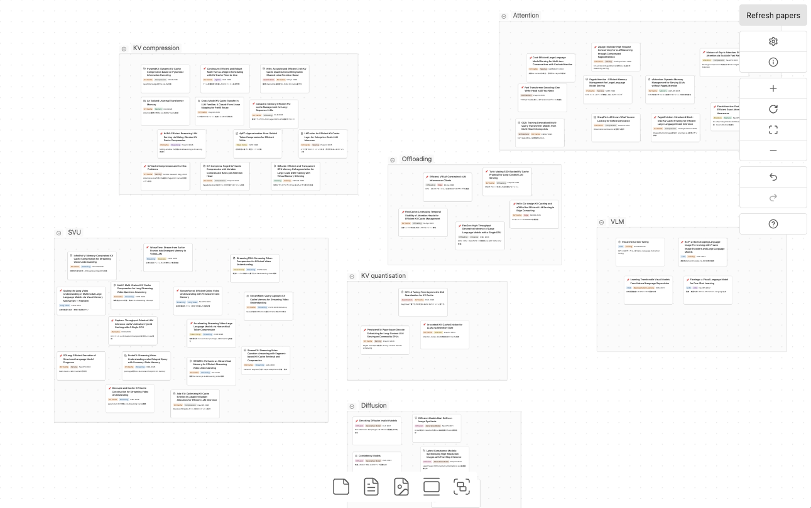

# Notion Canvas

Arrange any Notion database in **Obsidian's native Canvas** — projects, books, ideas, research, or anything else you track in Notion.

Drag cards, create groups, and draw connections. Click a card's title to open it in Notion.

## Install

1. [Download the ZIP](https://github.com/shu279/notion-canvas/archive/refs/heads/main.zip) and extract it.
2. Rename the folder to `notion-papers-canvas` and move it into your vault's `.obsidian/plugins/` folder.
3. Restart Obsidian and enable **Notion Papers Canvas** in Community plugins.

Desktop Obsidian **1.11.4+** is required. The built plugin is included.

## Connect a database

1. Create a [Notion internal connection](https://www.notion.so/profile/integrations) with **Read content** access and share your database with it.
2. In the plugin settings, create or select a **Notion token** using Obsidian SecretStorage.
3. Paste your **database link** and choose a Canvas path. For databases with multiple data sources, select **Data source ID** and enter the source you want.
4. Under **Notion property names**, map the fields below, then click **Refresh papers**.

| Card field | Notion property |
| --- | --- |
| Title | Your title property, or leave blank to detect it automatically |
| About | Text or a formula returning text, used as the summary |
| Tags | Multi-select |
| Venue | Text, select, multi-select, or a formula returning text; use it for any extra detail |
| Status | Status or select |

The defaults are `Paper`, `About`, `Tags`, `Venue`, and `Status`. **Rename these mappings to match your database, and leave unused optional fields blank.** Other property types are not displayed.

Each Canvas uses one data source. Choose a different Canvas path when switching databases. Entries with a `Screening` status show a 📌 icon.

Click **Refresh papers** on the right side of the Canvas to update anytime. The ribbon icon and **Refresh papers from Notion** command also work. Turn off **Open in desktop app** to use your browser instead.

After upgrading, refresh once to load Notion's full page URLs for existing-tab matching. If a page was renamed, refresh its link again; Notion matches the title in the URL as well as the page ID.

Cards default to a fixed **360 × 210** size. Change **Card width / height**, or turn off **Fixed card size** to resize freely. Keep the Canvas editable to move cards and draw connections; edit entry details in Notion.

## Sync behavior

- Existing cards keep their IDs, positions, colors, and connections. Groups and your own notes stay intact. Fixed sizing applies only to Notion cards; with it off, individual sizes are preserved.
- New entries appear in an **Unsorted · Notion** area beside the existing layout.
- All statuses are included. Missing or archived entries keep their cards.
- A failed or incomplete Notion query makes no Canvas changes. Close duplicate tabs of the same Canvas before syncing.
- A manually deleted database card returns on the next refresh.

Only mapped database properties are stored in the `.canvas` file; page bodies and attachments are not copied. The plugin never writes to Notion. Tokens stay in Obsidian SecretStorage.

## Try the layout

Open [examples/Papers.canvas](examples/Papers.canvas) with the plugin enabled to try a sample research database without a token.

Experimental plugin. Live updates use internal Canvas methods; if unavailable, close the Canvas tab before refreshing.

[Development and release instructions](DEVELOPMENT.md) · [MIT License](LICENSE) · Shu
